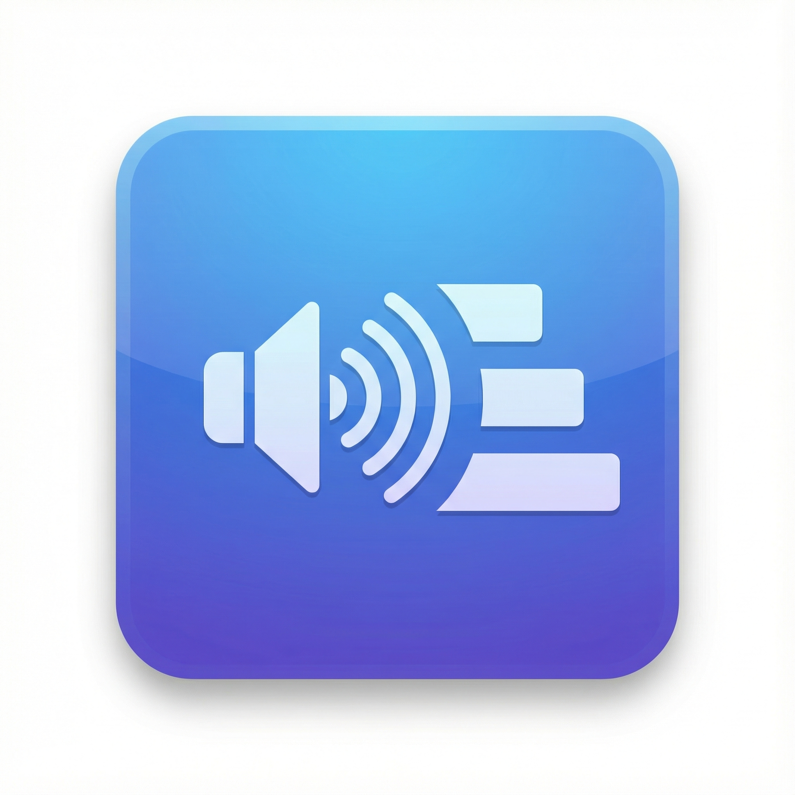
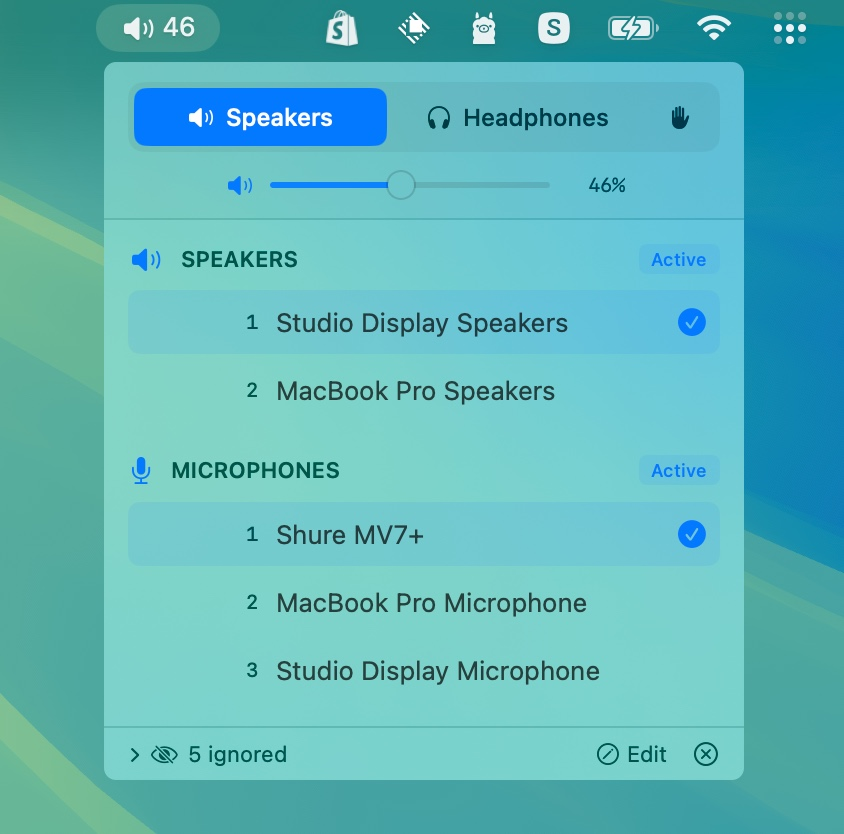

# Audio Priority Bar

<p align="center">
  
</p>

A native macOS menu bar app that automatically manages audio device priorities. Set your preferred order for speakers, headphones, and microphones - the app automatically switches to the highest-priority connected device.




## Features

- **Priority-based auto-switching**: Devices are ranked by priority. When a higher-priority device connects, it automatically becomes active.
- **Separate speaker/headphone modes**: Output devices are categorized as either speakers or headphones, each with their own priority list.
- **Manual override**: Enable "Custom" mode (hand icon) to disable auto-switching and select devices freely.
- **Optional microphone rules**: Rank microphone types, set lid conditions, and correct automatic device classification.
- **Device memory**: Remembers all devices you've ever connected, even when disconnected. Edit mode shows disconnected devices with "last seen" timestamps.
- **Per-category ignore**: Hide devices from specific categories without affecting others.
- **Drag-to-reorder**: Reorder devices by dragging or using up/down arrows.
- **Volume control**: Adjust volume with slider or scroll wheel.
- **Menu bar integration**: Shows current mode icon and volume percentage.

## Installation

### Requirements
- macOS 13.0 (Ventura) or later

### Build from Source

1. Clone the repository:
   ```bash
   git clone https://github.com/tobi/AudioPriorityBar.git
   cd AudioPriorityBar
   ```

2. Build using the build script:
   ```bash
   ./build.sh
   ```

3. The app will be at `dist/AudioPriorityBar.app`

Or open `AudioPriorityBar.xcodeproj` in Xcode and build with ⌘R.

### Download Release
Check the [Releases](https://github.com/tobi/AudioPriorityBar/releases) page for pre-built binaries.

## Usage

### Modes

| Mode | Icon | Behavior |
|------|------|----------|
| **Speakers** | 🔊 | Shows speaker devices, auto-switches to highest priority |
| **Headphones** | 🎧 | Shows headphone devices, auto-switches to highest priority |
| **Custom** | ✋ | Shows all devices, no auto-switching |

### Managing Priorities

- **Click a device**: Moves it to #1 priority (in normal mode) or just selects it (in custom mode)
- **Drag devices**: Reorder by dragging the handle
- **Up/Down arrows**: Fine-tune order on hover

### Device Actions (hover menu)

- **Move to Speakers/Headphones**: Change device category
- **Ignore as [category]**: Hide from current category only
- **Ignore entirely**: Hide from both speaker and headphone lists
- **Forget Device**: Remove disconnected device from memory

### Edit Mode

Click "Edit" in the footer to:
- See all devices ever connected (disconnected ones grayed out)
- Reorder disconnected devices in the priority list
- View "last seen" timestamps
- Forget old devices you no longer use

### Microphone Automation

Open **Microphone automation…** from the menu-bar panel. Rules are off by default, so existing device priorities continue to work. Turn on **Use microphone rules** to select the first connected input whose type and condition match.

- Use the arrow buttons to order microphone types.
- Choose **Always**, **When lid is open**, **When lid is closed**, or **Never** for each type.
- The device priority list breaks ties between microphones of the same type.
- Under **Microphone types**, keep **Auto** or choose an override. Overrides use the device UID and survive reconnects that retain that UID. A driver that changes its UID is treated as a new device. Selecting Auto removes the override. Forgetting a device removes its override.
- Custom mode (the hand icon) pauses automatic switching. Rule edits are saved during manual mode and take effect when automatic mode resumes.

Detection checks CoreAudio transport and input terminal metadata first. Built-in inputs, Bluetooth, Continuity Capture, virtual/aggregate inputs, and reported headset microphone terminals have explicit handling. Name hints such as “webcam” help identify USB camera inputs; the UI explains when a name hint was used. A USB connection or manufacturer name alone does not establish a headset type. If metadata is incomplete, choose a type manually.

Virtual and unclassified inputs default to **Never** when rules are enabled. Ignore and Never Use device settings still apply. If no input qualifies, the app leaves the current input unchanged and shows a status message. It does not mute the current input or invent a fallback. If lid state is unavailable, lid-specific rules do not match; use Always for a Mac without a lid.

Changes apply immediately in automatic mode. Speaker and headphone selection keep their existing behavior. This feature reads device metadata; it does not record audio or request capture permissions.

## Testing

On a Mac with Xcode installed:

```sh
sh Tests/run.sh
./build.sh
```

The tests cover classification, type overrides, selection order, lid conditions, and settings persistence using isolated preferences. See [Tests/UAT.md](Tests/UAT.md) for native UI and physical-device checks.

## How It Works

1. **Device Discovery**: Uses CoreAudio to enumerate audio devices and listen for changes.
2. **Priority Storage**: Device priorities are stored in UserDefaults, keyed by device UID (stable across reconnects).
3. **Auto-Switching**: When devices connect/disconnect, the app automatically selects the highest-priority available device for the current mode.
4. **Categories**: Each output device is assigned to either "speaker" or "headphone" category, with separate priority lists.

## Project Structure

```
AudioPriorityBar/
├── AudioPriorityBarApp.swift    # App entry, MenuBarExtra, AudioManager
├── Models/
│   └── AudioDevice.swift        # Device model, OutputCategory enum
├── Services/
│   ├── AudioDeviceService.swift # CoreAudio wrapper
│   └── PriorityManager.swift    # Priority persistence
└── Views/
    ├── MenuBarView.swift        # Main popover UI
    └── DeviceListView.swift     # Device list and row components
```

## Contributing

Contributions are welcome! Please feel free to submit a Pull Request.

## License

MIT License - see [LICENSE](LICENSE) for details.

## Acknowledgments

Built with SwiftUI and CoreAudio for macOS.
